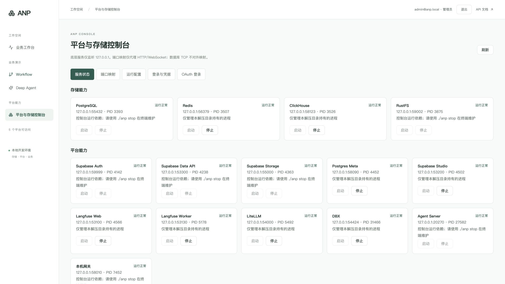
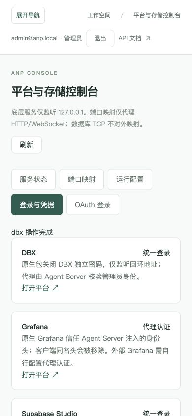
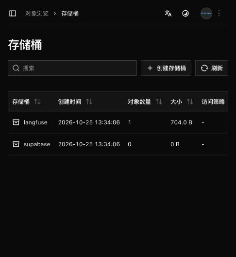

# 平台控制台与 OAuth：Mac 本机验收

2026-10-25，在本机 macOS **27.0.1 / ARM64** 完成原生候选目录验收。当前服务保留运行，可手动访问：

- 控制台：<http://127.0.0.1:58010/workbench/console/>
- 工作台：<http://127.0.0.1:58010/workbench/>
- 原生目录：`/Users/guangfeng/github/anp/var/native/console-macos-arm64`
- 初始化管理员：`admin@anp.local`。登录密码仅保存在该目录私有 `var/secrets/runtime.json` 的 `business-user-password` 字段，报告不包含密码。

本轮在既有候选包上叠加当前运行脚本、Business 源码/冻结依赖/前端、官方 Redis 与 OTel 产物，并修复签名与配置问题。**这是本机候选目录验收，不是新正式 Release、完整重新源码构建或新压缩包的干净环境验收。** 不把历史 CI 或 Linux 结果计入本轮。

## 结果与证据

| 范围 | 实际结果 | 回执 |
| --- | --- | --- |
| 回归与前端构建 | `make test` 115 项通过，TypeScript/Vite 构建通过 | [tests.json](console-macos-2026-10-25/tests.json) |
| 原生进程 | 完整停止再启动 20 个服务，20/20 就绪；后续管理操作后复查仍全部就绪 | [status.json](console-macos-2026-10-25/status.json) |
| 控制台 API | 22 项通过：状态、凭据边界、启停、外来端口拒绝接管、配置版本冲突、运行端口禁止直接修改、DBX 真实查询、Grafana PG 迁移 | [console.json](console-macos-2026-10-25/console.json) |
| Business | 24 项真实 Supabase / Agent Server 检查通过，包括角色、线程隔离、Workflow、Deep Agent 工具执行、退出与本轮数据清理 | [business.json](console-macos-2026-10-25/business.json) |
| Langfuse / LiteLLM | 10 项通过：真实管理台登录、错误密钥拒绝、合法项目密钥访问、OTLP trace 写入、worker 处理与读回 | [platforms.json](console-macos-2026-10-25/platforms.json) |
| OTel 三信号 | Collector → Tempo trace、Prometheus metric、Loki log 均真实写入并读回 | [otel.json](console-macos-2026-10-25/otel.json) |
| OAuth | 通过给定公司 OIDC 站点在本机 Chrome 完成真实授权码/PKCE 回调，建立 Supabase 会话；普通用户无控制台入口，明确配置 subject 后进入管理员控制台；测试后清空配置 | [oauth.json](console-macos-2026-10-25/oauth.json) |
| 入口映射 | 本机连接自身局域网地址，匿名请求拒绝；管理员可访问 DBX 与免二次登录的 Grafana；测试后恢复回环监听 | [ingress.json](console-macos-2026-10-25/ingress.json) |
| 监听审计 | 采集到的 30 个 TCP 监听地址全部为回环地址，包括内部附属端口和 Prisma 引擎端口 | [listeners.json](console-macos-2026-10-25/listeners.json) |
| 浏览器 | 点击 DBX 停止/启动成功；用户名密码显示及隐藏成功，未输出值；1920 宽屏铺满可用宽度，390 手机宽度五个标签页无横向溢出 | [ui.json](console-macos-2026-10-25/ui.json) |
| 候选目录完整性 | `./anp verify` 225079 个只读文件校验通过；配置及运行数据不收录 | [integrity.json](console-macos-2026-10-25/integrity.json) |
| 秘密检查 | 改动文本中未发现本实例的密码、JWT 或 API 秘密；公开固定 S3 用户名不作为密码匹配 | [secrets-audit.json](console-macos-2026-10-25/secrets-audit.json) |

`make doctor` 检测到所需工具齐全，但 Docker daemon 停止，因此该命令返回非零；本轮原生验收没有启动 Docker。Workflow / Deep Agent 使用离线演示模型；基础设施操作是真实调用，但 trace/log 内容为明确标记的合成验收事件，不代表真实模型供应商调用。

## 修改及原因

1. 新增独立管理员控制台，按存储、平台、观测分组显示状态，提供后台启停任务、配置编辑、代理映射和登录说明。控制台自身依赖的服务需在终端维护，防止关闭认证或入口后无法恢复。
2. 原生管理桥只操作当前目录持有的进程身份与进程组，不接受任意 shell 命令、路径或 PID。共享依赖仍运行时拒绝停止，外来端口占用不能通过页面接管。HTTP 网关只是上游路由，保持运行不阻止平台停止。
3. 原生参数固定回环监听；只有 Agent Server 入口可显式改为局域网监听。代理路径固定并强制管理员身份，上游地址可在线修改。配置采用 0600 原子替换、文件锁及版本摘要；代理覆盖配置不被启动器重写。
4. DBX 使用官方 `DBX_DISABLE_PASSWORD` 去掉二次密码。Grafana 使用官方 Auth Proxy，Agent Server 移除伪造身份头并注入已鉴权管理员，不开放匿名访问，不创建可绕过入口的登录 Cookie。Grafana 实际使用 PostgreSQL，迁移记录存在，未生成 SQLite 数据库。
5. Langfuse 和 LiteLLM 保留管理会话；管理员可按需查看本包初始化用户名密码，响应不缓存。原有 Langfuse UI 的直接网关分支已删除；SDK 的 `/api/public/*` 保留项目密钥校验，不能把人的控制台 Cookie 作为机器接口凭据。同步调整原生验收脚本的统一管理员登录步骤。
6. OAuth/OIDC 默认关闭，issuer/client_id/回调留空。Authlib 处理 state、nonce、PKCE 与 ID Token 校验；以 issuer+sub 隔离 Supabase 身份，不根据同邮箱接管管理员。管理员由显式 subject 清单决定；机密客户端支持 Basic/Post 认证，密钥只从服务端私有文件读取。修复首次 Supabase 链接可能为 `signup` 类型的问题，并在线程中处理配置文件操作，避免 Agent Server 阻塞检查报错。
7. 旧候选中的 RustFS、Auth、uv 被重新签名后出现 `SIGKILL`。恢复校验过的官方原始发行文件，保留有效上游签名，修复无效 PostgreSQL 库签名；源码 DBX 使用完整 ad-hoc 签名。未修改系统安全策略。官方 Redis 二进制在当前候选中运行正常。
8. 修正 Tempo 3.x 已移除 `compactor` 的配置格式，将 WAL、关闭标记和调度缓存限制到本目录 `var/`。Loki 在本机磁盘仍有数十 GiB 空间时触发默认 90% 水位并拒绝写入，现提供可配置的 98% 默认水位，保留磁盘保护，真实日志写入读回通过。

## 手动验收

应用内浏览器和本机 Chrome 均已登录初始化管理员，打开控制台后可以：

1. 查看「服务状态」，对 DBX 执行停止和启动，观察后台任务提示和状态变化。
2. 查看「端口映射」「运行配置」；运行服务的端口修改会被拒绝，修改需先停止对应服务。局域网入口变更需重启，当前保持仅本机。
3. 在「登录与凭据」打开 DBX / Grafana，确认无需二次登录；查看 Langfuse / LiteLLM 初始化凭据后手动登录。凭据切换标签或隐藏页面后收起。
4. 在「OAuth 登录」配置提供方；默认关闭。公司站点示例、Google 配置字段和 subject 权限说明见[使用说明](../development/平台控制台与OAuth.md)。

终端管理：

```sh
cd /Users/guangfeng/github/anp/var/native/console-macos-arm64
./anp status
./anp stop
./anp start
```

## 明确边界

- Supabase Studio 与当前 LiteLLM UI 的官方根路径产物仍通过独立本机地址打开；不声称已经完成它们的子路径局域网代理。
- 核心控制台依赖服务通过终端维护；页面不提供杀死自身认证和存储依赖后的恢复能力。
- 局域网检查使用本机自身网卡地址，未从第二台物理设备访问。
- 公司 OAuth 的真实回调已验证；内嵌浏览器受可信设备认证限制，真实公司授权使用本机 Chrome 完成。Google 及其他提供方的真实账号尚未验证。
- 新压缩包、干净 Mac、Linux、GitHub Actions / Release，以及真实模型供应商均未在本轮重新验收。

## 页面截图






## RustFS 后台补充验收

RustFS 后台已接入 <http://127.0.0.1:58010/rustfs/console/>，存储卡片增加「打开后台」，管理员「登录与凭据」增加 RustFS Access Key / Secret Key 查看。复用既有官方 RustFS 二进制，没有重新编译上游。

- 后台登录和真实存储桶列表已在浏览器验证。
- S3 API `127.0.0.1:59002`、后台 `127.0.0.1:59003` 均为回环监听，当前仍为 20 个服务，见 [RustFS 监听回执](console-macos-2026-10-25/rustfs-listeners.json)。
- `make test` 当前 **119 项通过**，前端构建通过，见[补充回归回执](console-macos-2026-10-25/rustfs-tests.json)。
- **8 项真实代理验收通过**：有效 S3 密钥仍须 ANP 管理员登录、错误签名拒绝、读取已有桶、创建临时桶、含中文及空格路径的对象写入读回、预签名 URL、清理本轮临时资源、凭据一致且不缓存。见 [RustFS 回执](console-macos-2026-10-25/rustfs.json)。没有删除已有 `langfuse` / `supabase` 桶或其中对象。
- 官方前端会发出根路径 S3 请求，因此同时配置了网关路由与 Agent Server 中间件；先验证 ANP 管理员，再保留原路径、Host、查询串及 S3 签名，避免只代理静态页面导致登录失败。普通中文查询不会被误判为 S3 请求。




## Supabase Studio 断点续传上传修复

截图中的 ProgressEvent 已在独立 Studio 端口 53200 → 网关 58010 的真实浏览器上传中复现。Chrome 网络事件明确指出 `HeaderDisallowedByPreflightResponse`，拒绝的头为 `x-source`。另发现 Storage 生产模式生成 HTTPS 地址，且代理剥离 `/storage/v1` 后续传地址缺少前缀。

网关在 Storage 响应中补充允许 `X-Source`、`X-Client-Info`，向上游提供固定 `X-Forwarded-Prefix: /storage/v1`，并将 TUS Location 对齐到当前网关的协议和完整 host:port。保留 Storage 自身的鉴权及其已有 CORS 头；不改官方发行包。

真实验收：

- 浏览器小文件 35 字节上传成功；8 MiB 分块上传 POST 201、PATCH 204，两个文件回读字节及 SHA256 一致。
- 独立私有临时桶：POST 首块 6 MiB、HEAD 确认 offset、PATCH 剩余 2 MiB、完整回读一致；续传 URL 的 HTTP、58010 端口和 `/storage/v1` 前缀正确。
- 仅清理自建验收对象与临时桶；用户 `test` 桶保留；未读取截图中的 cookies 文件。
- `make test`：119 passed，TypeScript/Vite 构建通过。

复现命令：`python scripts/check_native_storage_tus.py /Users/guangfeng/github/anp/var/native/console-macos-arm64`。该命令使用运行目录内的私有凭据，不输出凭据，只创建及清理自己的随机临时桶。

证据：`console-macos-2026-10-25/storage-tus.json`、`storage-tus-browser.json`、`storage-tus.png`。本次已应用到本机验收目录并重启网关，未制作新发行包、未发布 Release；Mac ARM64 实测，Linux 未重测。
