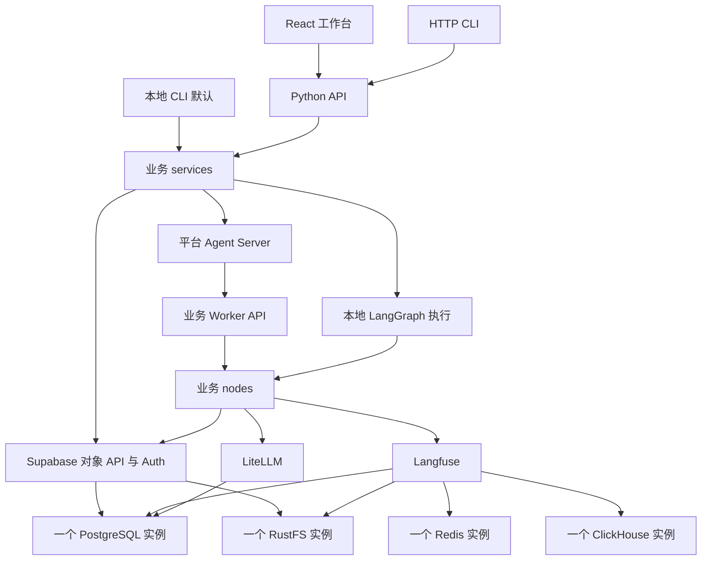

# 架构与数据库划分

业务代码均位于 `apps/<id>`。平台统一提供图宿主和基础设施；图定义归业务，镜像构建时包含业务图。HTTP 图中的每个节点通过 API 调用 Worker，本地执行则直接调用同一 nodes，无需 Worker/API 进程。

`services` 负责任务用例与权限，`nodes` 负责各阶段逻辑，`flow` 负责 State、边和编排。`api`、CLI、UI 都是入口，不各自实现一套业务规则。当前示例是文本分析：normalize → analyze → save，确定性执行不消耗真实模型额度。接入模型时在节点调用 LiteLLM。

## 资源归属

| 资源 | 划分 | 用途 |
|---|---|---|
| PostgreSQL `postgres` | `auth`、`storage`、`platform`、`app_demo` schema | Supabase、账号、权限、任务、节点返回值、业务结果 |
| PostgreSQL `agent_local` | 独立 agent 账号 | 本地 CLI LangGraph checkpoints |
| PostgreSQL `litellm` | 独立 litellm 账号 | 网关配置 |
| PostgreSQL `langfuse` | 独立 langfuse 账号 | 追踪管理数据 |
| Redis | 一个实例，Langfuse 自身前缀 | Langfuse 队列；不另开 Redis |
| ClickHouse | 一个实例 | Langfuse 分析数据 |
| RustFS `supabase-storage` | Supabase 存储后端 bucket | 工作空间私有文件，由 Storage API 做权限校验 |
| RustFS `langfuse` | events/media/exports 前缀 | 追踪归档 |
| Docker 每业务 Agent 状态卷 | `.langgraph_api` | 官方开发运行时的 threads/runs/checkpoints |
| Docker DBX 状态卷 | `/app/data` | 预配置连接及用户新增连接 |

`database-init` 仅运行一次 psql 客户端，不是第二个 PG 实例。业务对象通过 Supabase API，CLI 的本地图 checkpointer 通过配置连接 Docker PostgreSQL。

## 权限

Supabase Auth 签发用户 JWT。业务 API 和本地 CLI 验证身份与工作空间成员；数据库 RLS、文件路径权限继续检查同一用户身份。viewer 只读，developer 可创建/执行/取消自己的工作空间业务任务，admin 管理成员；平台管理员才能看到基础设施入口。

Worker 使用独立内部令牌，仅执行数据库中真实任务和对应 attempt。Agent Server 使用独立引擎令牌。service_role、数据库密码、Worker token 不发送到工作台浏览器。任务身份与原始输入不可通过 REST 更新篡改。幂等键支持重复创建去重，节点返回值持久化；外部副作用仍应使用业务自身幂等键/事务，MVP 不承诺分布式 exactly-once。

本地 CLI 是前台运行，关闭进程会中断当次执行；长时间后台任务应使用 HTTP / 平台运行。当前 Agent 是官方 `langgraph dev` 开发引擎，适合本地 MVP，其磁盘状态卷不等同于生产分布式队列或 HA 部署。迁移生产时使用支持的持久化部署模式并重新验收。

## 第三方集成

平台组件使用 Docker 镜像和已提取的必要上游配置；镜像 digest 在 `platform/images.lock.json`，配置来源在 `platform/upstream.lock.toml`。没有运行时 git clone/submodule 要求。业务 Python 库由 uv.lock 锁定，前端由 pnpm-lock.yaml 锁定。

DBX 支持这里预置的 PostgreSQL/Redis/ClickHouse。RustFS 使用它自己的 S3 控制台；不会伪造 DBX 不具备的 S3 管理能力。第三方后台保留其自身认证，不把 Supabase 登录误称为全部后台 SSO。

官方 [Studio 文档](https://github.com/langchain-ai/docs/blob/main/src/oss/langgraph/studio.mdx)说明 Studio 网页通过 baseUrl 连接本地 Agent Server；本项目提供配置和入口，LangSmith 账号登录由用户自行完成。
