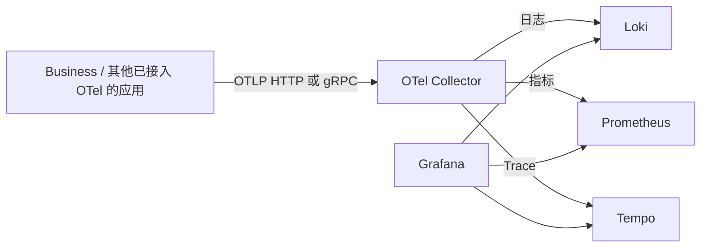

# OTel / LGTM 原生集成调研

日期：2026-10-25。范围：Mac ARM64、Linux x64、Windows 通过 WSL 使用 Linux 包。调研后已按用户授权接入构建和运行管理源码；用户随后要求 Grafana 使用存储层 PostgreSQL，已同步实现。本轮没有构建、启动或验收，也未升级现有服务。实际用法见 [使用说明](../development/OTel-LGTM使用说明.md)。

## 结论

可以沿用 grafana/otel-lgtm 的配置思路，用各组件的官方二进制组装 ANP 可选观测模块，无需编译这些上游项目，也无需从 Docker 镜像抽取文件。grafana/otel-lgtm 本身是容器集成项目，不是单个跨平台可执行文件。

核对当前上游 Dockerfile，其实际启动组件为 Grafana、Prometheus、Loki、Tempo、OpenTelemetry Collector Contrib 和 Pyroscope，另有可选 OBI/eBPF。概述文档仍有 Mimir 表述；本方案按实际 Dockerfile 和数据源配置使用 Prometheus，不另加 Mimir。

参考：[项目](https://github.com/grafana/docker-otel-lgtm)、[实际构建文件](https://github.com/grafana/docker-otel-lgtm/blob/main/docker/Dockerfile)、[数据源配置](https://github.com/grafana/docker-otel-lgtm/blob/main/docker/grafana-datasources.yaml)。上游将该整合镜像定位为开发、演示、测试环境，不能据此宣称高可用生产部署已经解决。

## 官方产物清单

以下版本来自本次核对的上游构建文件，是候选组合；集成时仍需固定上游提交、下载 URL、SHA256，并做组合验收。

| 组件 | 作用 | 候选版本 | Mac ARM64 | Linux x64 | 第一阶段 |
| --- | --- | --- | --- | --- | --- |
| Grafana OSS | 查询界面、仪表盘 | 13.2.4 | 官方 tar.gz | 官方 tar.gz | 包含 |
| OTel Collector Contrib | 接收、处理、转发 OTLP | 0.163.1 | 官方 darwin_arm64 tar.gz | 官方 linux_amd64 tar.gz | 包含 |
| Prometheus | 指标存储和查询 | 3.15.1 | 官方 darwin-arm64 tar.gz | 官方 linux-amd64 tar.gz | 包含 |
| Loki | 日志存储和查询 | 3.7.9 | 官方 loki-darwin-arm64.zip | 官方 loki-linux-amd64.zip | 包含 |
| Tempo | Trace 存储和查询 | 3.1.1 | 官方 darwin_arm64 tar.gz | 官方 linux_amd64 tar.gz | 包含 |
| Pyroscope | 持续性能剖析 | 2.4.1 | 官方 darwin_arm64 tar.gz | 官方 linux_amd64 tar.gz | 可选扩展 |
| OBI / eBPF | 自动探测进程和网络调用 | 上游可选项 | Linux eBPF 路径不适用 | 涉及内核能力和权限 | 不默认加入 |

发行来源：[Collector](https://github.com/open-telemetry/opentelemetry-collector-releases/releases/tag/v0.163.1)、[Prometheus](https://github.com/prometheus/prometheus/releases/tag/v3.15.1)、[Loki](https://github.com/grafana/loki/releases/tag/v3.7.9)、[Tempo](https://github.com/grafana/tempo/releases/tag/v3.1.1)、[Pyroscope](https://github.com/grafana/pyroscope/releases/tag/v2.4.1)。已经核对对应架构附件；尚未下载运行全部组件。

Grafana 官方下载 API 已实际返回两个架构的地址与摘要：

- Mac：`https://dl.grafana.com/grafana/release/13.2.4/grafana_13.2.4_38252365904_darwin_arm64.tar.gz`，SHA256 `a910966466359212f1d875748a72a4638c7d3724448d0c369210b31d763b165d`。
- Linux：`https://dl.grafana.com/grafana/release/13.2.4/grafana_13.2.4_38252365904_linux_amd64.tar.gz`，SHA256 `c48765988fd88572607e4ea670251af8a8e64ab3e360d0f3cf67a6f3587b92ab`。

本地查询记录位于 `var/native/research/otel-lgtm-2026-10-25/`。部分 GitHub Release API 查询遇到匿名限流，改为核对官方发行附件页面；不能把 API 错误记录当作运行验收回执。

## 运行关系



Grafana 按用户要求复用存储层 PostgreSQL，内置模式使用独立数据库和账号，云模式使用既有数据库内的独立 schema；不使用 SQLite。Prometheus 本地 TSDB，Loki 和 Tempo 使用本地文件目录。不额外启动 PostgreSQL 实例，也不新增 Redis、ClickHouse 或 S3 服务。业务对象依旧通过 Supabase 管理。

后续如果需要集中部署，再独立配置观测后端和对象存储；不默认复用已有业务 OSS 桶和前缀。

## ANP 目录与管理方式

建议保留现有顶层目录，新增一个组件分组：

```text
platform/otel/
├── collector/
├── grafana/             # 保留 bin、conf、public 等完整运行目录
├── prometheus/
├── loki/
└── tempo/
defaults/otel/          # 默认配置、数据源、仪表盘模板
native/locks/otel-<target>.json
manifest/otel-sources.lock.json
var/data/otel/          # 各组件的数据库、TSDB、WAL、chunks、blocks
var/run/otel/           # 按本实例地址和当前路径生成配置
var/logs/               # 沿用服务日志目录
var/secrets/runtime.json
```

启动器直接管理五个进程的启动、健康检查、退出、端口占用和回滚，不照搬上游需要额外 Bash 能力的 run-all.sh。路径从当前包位置计算，所有可写状态放在 var，搬移后重新生成配置。

Grafana 应打包完整官方运行目录，使用内置 Prometheus/Loki/Tempo 数据源，不在启动时在线安装插件或下载仪表盘；额外插件以后按版本和架构锁定。上游 dashboard、provisioning 配置作为参考，固定来源提交并保留许可证。

建议增加逻辑组 observability，提供整组启动与逐项服务选择，但目前命令尚未实现。模块可以预装，默认关闭；由用户选择启用，避免全部平台启动时额外占用大量内存和磁盘。

观测配置与业务存储配置分开：

- off：不启动观测进程，不启用自动导出。
- local：启动本地 LGTM 组，并保留本地观测数据。
- external：仅启用 Collector 转发到已配置的外部观测后端，Grafana 使用外部链接。

现有业务外部资源模式只关闭四个本地业务存储，不能因此推定本地 LGTM 也没有存储文件。若要求本地不保存观测数据，应选择 external，并单独决定 Collector 是否启用磁盘队列。

## 端口与统一入口

内部端口全部纳入现有 ports、冲突预检、归属和监听审计；以下仅为候选默认值：

| 功能 | 候选端口 / 路径 |
| --- | --- |
| Grafana | 内部 53000；统一入口 /grafana/ |
| Collector OTLP HTTP | 4318 |
| Collector OTLP gRPC | 4317，可按需关闭 |
| Collector 健康检查、自身指标 | 13133、8888 |
| Loki | HTTP 3100，另有受管内部 gRPC / ring 端口 |
| Tempo | HTTP 3200、OTLP 4417/4418，另有内部端口 |
| Prometheus | HTTP 9090 |

所有监听须显式绑定 127.0.0.1，不能直接复用上游的 0.0.0.0 监听。上游组件还会启用 gRPC、memberlist 等辅助监听，必须完整登记，不能只检查表中的主端口。

Grafana 使用官方 root_url、serve_from_sub_path 配置实现 /grafana/；Business 平台导航增加入口，复用管理员路由保护。Grafana 本身仍保留独立登录并生成随机管理员密码，不照搬镜像的 admin/admin 或默认匿名访问。需要支持 Grafana Live 的 WebSocket 代理。Grafana 官方配置参考：[配置文档](https://grafana.com/docs/grafana/latest/setup-grafana/configure-grafana/)。

进一步检查代码确认：现有 Business 平台代理已经实现 HTTP 和 WebSocket 转发，并对两者同时执行管理员和来源检查。本轮新增 /grafana/ 复用这条路径，仍保留 Grafana 独立登录，不将其描述为已经接入 Supabase SSO；运行效果尚未验收。

OTLP 使用独立本机端口，避免给 gRPC 反向代理和路径重写增加不必要复杂度。Windows 原生 Business 连接 WSL 的 OTLP HTTP 端口；localhost 转发尚待实测。当前包内实现 local/off 开关，外部观测后端转发仍是后续方案；独立 Business 已可配置外部 OTLP endpoint。

## Business 与 Langfuse 的边界

复用现有 LangGraph Agent Server 的 HTTP 扩展，不增加业务 HTTP 服务器。对其接入 OTel SDK/中间件，为请求、Workflow、Deep Agent 工具调用、关键外部 HTTP 调用建立 span；提供应用指标和包含 trace_id/span_id 的结构化日志。

仅设置 OTEL_EXPORTER_OTLP_ENDPOINT 不会自动让所有组件产生遥测。必须确认已有框架的 Provider/Exporter，避免重复注册、重复 span 和重复计数。资源属性至少明确 service.name、service.version、service.namespace、service.instance.id。

日志可通过 SDK 导出，或让 Contrib 的 filelog receiver 采集当前实例 var/logs；同一日志只选择一种路径，避免重复入库。请求头、token、密码和正文不默认采集；trace_id 放在日志结构化元数据，避免作为高基数 Loki 索引标签。

LGTM 负责通用请求链路、服务日志和运行指标；Langfuse 保留模型调用、prompt、成本、Agent 语义。二者并存，先按 trace_id 关联；如要把同一模型 span 同时导出到两端，需另验 Langfuse OTLP 属性与认证，不能直接假定所有通用 span 都能复用。

## 必须完成的验收

1. 下载固定官方二进制并校验摘要，验证配置和启动，审计包外库依赖及全部监听。
2. 用独立探针发送唯一 trace、counter 和日志；经 Collector 写入后，从 Tempo、Prometheus、Loki 实际查询读回，不能只看接收 HTTP 200。
3. 通过 Grafana 数据源实际查询三类数据，并检查 /grafana/ 下的页面、资源、登录与跳转。
4. 实际运行 Business Workflow、Deep Agent，检查请求、节点、工具调用和日志关联，避免重复导出。
5. 停止、重启、包含空格和中文路径的搬移，验证观测数据持久化、不可变文件清单和配置重建。
6. Mac ARM64 与无外网 Debian/Alpine Linux x64 分别验收；Windows 到 WSL 的 OTLP HTTP 单独验收。
7. 测量新增归档体积、空闲/运行内存和观测数据增长，设置保留周期与容量上限后再决定是否默认启用。

当前仅确认官方二进制供应和可行的集成方式，尚未证明上述运行验收通过。
