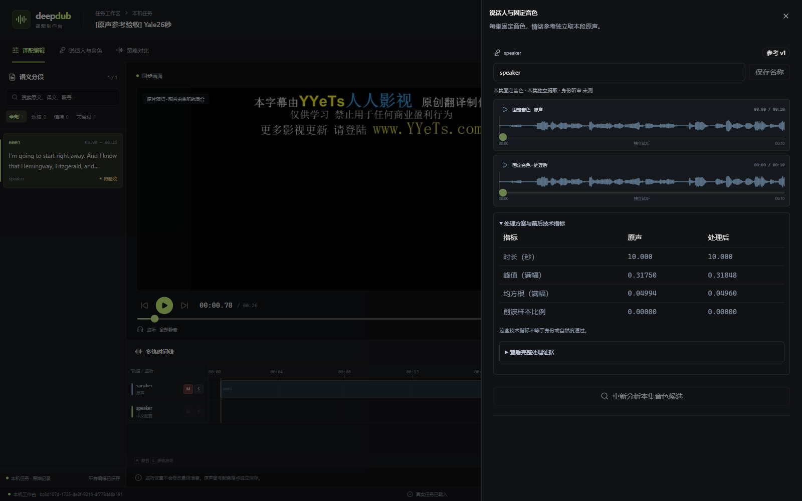

# 原声参考准备与详情页试听验收

## 已运行验证

2026-10-18：正式 V3 业务服务增加固定音色和逐段情绪参考准备。业务代码保留在 `apps/deep_dub`，没有增加存储实例、数据库表或修改平台镜像。

- `nodes/references.py` 实际执行 FFmpeg，按媒体时间轴准确截取原声，生成单声道 24 kHz PCM16。保留输入摘要，检查前后文件及样本数；拒绝静音、非法窗口和任意过滤表达式。支持原样转换 `raw` 与固定语音频段 `speech-band`，后者不是已验证的降噪或人声分离。
- `services/references.py` 使用当前身份读取私有输入、领取本地 CPU 阶段与租约、保存 RustFS 音频和 JSON 证据，追加不可变参考登记。固定音色窗口必须位于同角色段内且为 3–20 秒，默认前 10 秒；情绪参考必须精确覆盖本段原声窗口，不受配音落点影响。
- API：`POST /api/apps/deep_dub/runs/{run_id}/prepare-reference`，参数含 `segment_id`、`kind=voice|emotion`、`filter_mode=raw|speech-band`，请求头带 `Idempotency-Key`。默认本地 CLI、HTTP CLI 和 API 复用同一个业务服务；匿名、查看者、外空间和非法窗口实测拒绝。
- 真实服务验收新截取既有原片的 26 秒，沿用既有第一段文字。音色窗 0.78–10.78 秒，两版各 240000 样本；情绪窗 0.78–25.30 秒。原/处理音色不同产物，原样情绪共用同一音频，不重复输出。幂等重放返回同一阶段；测试运行结束取消，未创建审核或 TTS 候选。
- 21 项工具检查（参考 9、波形 10、媒体 2）通过；1 项真实 API/业务服务/两种 CLI 集成通过；TypeScript 和 Vite 构建通过。入口块仍有大于 500 kB 的构建提示，没有将其记为性能验收。

```powershell
# 已创建并启动同来源运行后，使用实际 UUID。
uv run anp deep_dub runs prepare-reference <运行UUID> <段UUID> voice --filter-mode speech-band --request-key <幂等键>
uv run anp --transport http --endpoint http://127.0.0.1:8183 deep_dub runs prepare-reference <运行UUID> <段UUID> emotion --request-key <幂等键>
```

## 详情页交互

正式开发入口使用独立业务端口 8767/8183。说话人与音色通过 shadcn Sheet 展开，原声与处理版分别显示真实波形、时间与播放控件，独立试听互斥，不修改最终混音。指标用 shadcn Table 前后对比，保留足够小数，完整 JSON 证据另行折叠；身份听审明确保持“未测”。

浏览器实测音色两版均为 10 秒、`readyState=4`、无媒体错误。此前试听切换时原版暂停，处理版开始播放。受控移除本机播放 Cookie 后，两版报错；第一次重连恰遇 API 503，界面保留真实错误。服务恢复后分别点击“重新连接”，重新按当前用户签发媒体会话并载入波形，两版恢复到 10 秒、`readyState=4`，没有放宽身份或 TTL。

截图对应浏览器验收项目 `bc8d107d-1725-4e2f-9216-4f778446a191`；最终集成测试另建独立项目，ID 见 JSON，不混作同一次运行。



## 已实现未验证与后续

- 当前段“提取音色参考”“提取情绪参考”按钮已连接同一 API，缺少权限、同来源运行或运行取消时禁用。本轮未在浏览器中正向点击生成，不将 API/CLI 成功等同 Web 写入验收。
- 后台 90 秒续期已实现，但没有单独做长时间后台计时验收。受控失效恢复仅覆盖参考 WavePlayer，不代表所有视频、多轨 transport 和网络故障已全部恢复验证。
- 所有验收数据为 acceptance。没有全新整片下载、独立 ASR、来源身份通过、听感/音色身份通过、TTS、背景分离、成片、整片 RTF 或发布回执。
- 原 372 条 Agent 状态值全部保留，结束快照 392 条包含同期其他验收；27 个受保护容器 ID 不变。未重建正式平台。

## 模型服务开发准备（不计推理通过）

外部业务计算源码 `audio.cpp` 在干净提交 `f16f23abf9732b1904fed1f15bddbe9909d21146` 构建本机 CUDA 服务，独立回环端口 18110、惰性加载、最多一个模型。构建二进制 SHA256 为 `be820dd89b644b7179614a0444b0be5ad123e81c7794add19619e4cf6a95c81d`；健康和模型列表 200，模型 `loaded=false`。这是开发实例，不是平台正式镜像或已发布制品。缓存权重仅核对文件名/字节数，未核对完整摘要；运行器提示旧模型规范，实际推理兼容性未测。

远端 V100 已有四个模型进程且占用约 14.9/16 GiB，仅只读检查，未卸载或停止；本机开发服务尚未加载权重或生成。后续必须确认设备所有权、租约、冷加载计时及取消后的真实停止，再做 TTS。不能用健康响应、旧报告或 GPU 利用率 0 代替资源可用及本轮性能证据。

结构化证据：`evidence/deep-dub-reference-20261018.json`。私有日志位于 `.local/deep-dub-reference-*.log`，不含于发布包。
