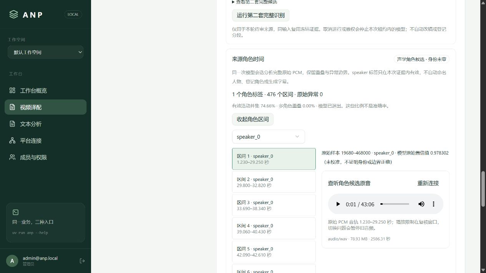

# deep_dub 来源角色时间分析

状态：已完成同一真实整轨的角色时间分析及 API、两 CLI、Web 验证。结果是声学角色与区间候选，正文、人物身份、区间边界和字幕时钟仍未通过审核；未登记正式说话人、分段或音色。

## 用法与边界

工作台「来源角色时间」可启动分析，展开后按标签筛选、分页及查听原音。一次请求提交完整原始 16 kHz PCM，避免在不同固定块之间直接拼接局部角色标签。标签仅在本份模型证据内有效。

```powershell
uv run anp deep_dub runs analyze-source-speakers <运行UUID> <来源UUID> --request-key <稳定键>
uv run anp deep_dub projects source-speaker-timing <项目UUID> <来源UUID>
```

默认 CLI 直接调用业务服务，无需业务 Web；仍依赖平台认证、数据、对象与观测服务。根参数 `--transport http` 使用相同契约。HTTP 为 POST `/api/apps/deep_dub/runs/{run}/analyze-source-speakers`、GET `/api/apps/deep_dub/projects/{project}/sources/{source}/speaker-timing`。

配置 `[deep_dub].diarization_config`，格式沿用严格的 `ModelConfig`。模型为 `nemotron_3_diar`，task 为 `diar`，offline 会话使用 `very_high` 配置；阈值 0.5、最短区间与补边均为 0。没有正文提示，不输出或使用隐藏的期待文字。

迁移 019 对待审运行只增加当前绑定来源、GPU、审核权限下的证据计算。沿用物理 GPU UUID、原跨应用协调锁、完整桌面进程路径白名单和设备租约，取消或撤权会停止本次进程。不得借该阶段登记来源、转录或其他生产候选；原待审状态、排队起点与旧证据保持。

原始区间及置信值保存在私有 JSON 证据。统计区分有效区间的活动并集、多角色重叠以及单区间越界/倒置；异常原值不裁改。相同角色的重叠不会伪算成多角色重叠。置信值未校准，活动比例不是正确率；零重叠也不证明没有漏检或串话。

## 模型来源

使用本机已存在的 [audio-cpp GGUF 转换制品](https://huggingface.co/audio-cpp/Nemotron-3-Diarization-GGUF/tree/647d39feaa0e91dca5ce355a95403837b76dff56)，不是 NVIDIA 原始权重。实际文件 198,720,928 字节，SHA-256 `84f6f0f12b9ecf2615548427e884534a72fedbca32d00872d95c0f72a078c953`，与该固定提交的 LFS 元数据逐字节摘要一致；本轮未下载或替换该缓存。不把旧安装记录中的 `main` 当作固定修订。

执行器仍为已核验的本机 audio.cpp CUDA 二进制，身份与源码修订随证据冻结。运行日志实际记录 RTX 5060 Ti 和 CUDA graph warmup complete；未声称采集了显存峰值或使用远端 V100。

## 已运行验证

真实来源仍为 Yale HIST119 第一讲、当前待审验收运行。完整 PCM 共 41,380,932 样本（2586.30825 秒）。模型返回 1 个标签、476 个区间，单区间越界/倒置为 0；有效活动并集 30,895,520 样本（74.661247%）、模型返回的多角色重叠为 0。不能据此命名讲者、断言整片只有一个人或放行正文。

本角色阶段首次真实尝试成功；阶段时间 23.188 秒，节点时间 16.031 秒，模型会话 15.984 秒。三者口径不同，不相加，不作为整片 RTF。一个受控原生进程真实退出，退出码 1 原样保留，设备租约 released 且 operation_stopped=true；不是将超时或 HTTP 返回当作进程退出。

真实专项 45.02 秒通过：HTTP 执行完整推理，本地与 HTTP CLI 完成读取及缓存重放；业务 URL 指向不可达端口的本地 CLI 仍可读取和重放。六项 Langfuse 评分实际读回，四项技术量有值，人物身份、边界复核保持 not_measured；user/session 绑定任务发起者与运行，执行者另由 attempt 记录。401、跨空间 404、只读用户执行 403 均真实验证。

Web 已验证显示 476 区间、下一页进入 11–20、标签筛选重置第一页。原音实际播放无媒体错误，第一窗口在 29.250 秒自动暂停；网页确认重放后 GPU 日志摘要不变，没有新增模型进程。当前正式角色表、分段、审核、原队列与业务运行均未改变。

55 项工具检查通过（17.48 秒），包含真实 HTTP 子进程的取消、异常、输入变化和监听 PID 校验；初版夹具使用 Windows venv 启动器，监听属于派生解释器而被拒绝，已改用真实解释器，未跳过归属检查。诊断在 `.local/deep-dub-speakers-fixture-failure.log`。49 项独立库关系与执行回归通过（24.91 秒），包括重复执行 019、错误设备/来源拒绝与禁止候选登记。最终生产联合回归、冻结制品及保护性检查见 [公开证据](evidence/deep-dub-source-speakers-20261019.json)。

冻结制品 `20261018204720-115495b2` 已真实重建并经 Compose 启动，11 组件 ready；本轮 Python/SQL 在业务 wheel 中与工作树逐字节一致。30 项生产联合回归通过（122.72 秒），其中角色只读回归没有再次计算模型；GPU 日志仍为同一条已退出进程。原 454 条线程值、完整待审父子检查点、27 个受保护容器 ID 均保留，现 456 条线程；五库备份隔离恢复通过。制品来自含其他会话修改的本机工作树，不是新官方 GHCR 发布或拉取验收。



## 未完成

角色时间目前是可独立调用的业务阶段，尚未自动接入旧 v1 来源准备子图的放行分支；旧父子检查点必须继续保持待审。后续仍需正文裁决、可信语义分段、角色与固定音色映射、字幕时钟、完整整片生产、全质量门禁及完整墙钟 RTF≤0.5、真实 B站发布回执。本轮没有新 GHCR 发布/拉取或 IDE F5 复验，不能用角色分析代替整体交付。
