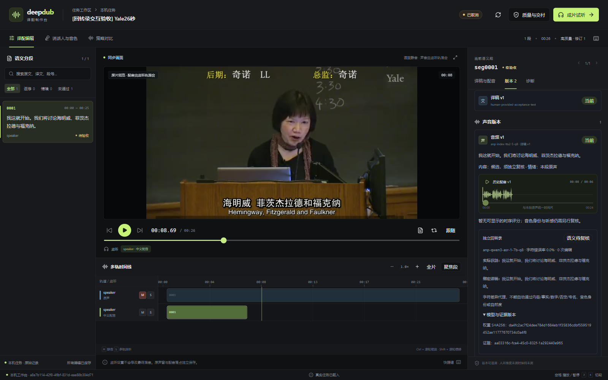

# 独立回转录、字符差异与声音版本证据

## 已运行验证

2026-10-18，本机真实新生成 WAV 已接入独立 Qwen3-ASR 回转录。当前结果作为字符差异证据，不自动创建语义、事实、数字、否定、专名或听感审核通过。

| 检查 | 结果与范围 |
| --- | --- |
| 工具检查 | 24 passed in 5.91s：ASR 17 项与原受控 TTS 7 项；包含真正的 HTTP 子进程、上游错误、非法响应、取消、输入改变、空转录及保留数字/符号的比较。HTTP 夹具不是实际模型识别 |
| 真实集成 | 1 passed in 45.78s：既有原片新截 26 秒，人工给定短中文，实际生成新的 WAV，再调用独立 ASR；API、业务服务、默认本地 CLI 与 HTTP CLI 重放同一阶段 |
| 实际识别 | `我这就开始，我们将讨论海明威、菲茨杰拉德与福克纳。`；仅标点与期待短中文不同，规范化 CER=0、编辑距离=0，没有把短中文当成整段原文的完整翻译 |
| 提示独立性 | ASR 请求固定 `text=""`，仅给 Chinese 语言提示，不把期待译稿、专名或原文送给 ASR 作上下文。期待文本只在识别完成后比较 |
| 原身份与隔离 | 查看者可 GET 读取证据，不能 POST 执行；匿名和外空间拒绝。候选音频、绑定译稿、原片来源、模型摘要与输入摘要重新核对 |
| 真实 Web | 在具体声音版本点击“独立回转录”，载入识别文本、绑定译稿、CER、编辑次数及权重/证据版本。取消运行后按钮禁用，已有证据仍可按权限读取 |
| Langfuse | 实际读回 `tts_asr_character_error_rate=0` 及 TEXT `tts_asr_semantic_review:status=not_measured`；v2 observations 的 userId/sessionId 与当前执行者和运行一致 |
| 生命周期 | ASR 模型进程已确认退出、GPU 租约 released，未遗留本机 `audiocpp_server.exe`；没有新建质量审核或选版 |
| 构建与保护 | TypeScript、Vite 构建通过，入口块大小提示保留；420 条既有 Agent 的全部状态值及 27 个受保护容器 ID 保留 |

本轮全部是 **acceptance**，不是生产整片。原文沿用既有第一段，短中文人工提供，并未覆盖完整原段含义；未进行原片新下载、整片 ASR、翻译完整性、成片或 RTF≤0.5 验收。操作完成后验收运行已取消收尾。



## 实现与配置

- `nodes/transcribe.py` 核对实际输入 SHA256，在租约中转换为单声道 16 kHz PCM16，核对时长与前后摘要。ASR 通过本次受控原生进程的 HTTP 接口识别；核验监听端口的实际 PID、惰性状态和模型 ID。响应保留原始文本及模型报告计时，进程确认退出后才允许释放设备。
- `services/model_pool.py` 新增明确的 `qwen3_asr` 家族，与 TTS 共用同一物理 GPU 日志、文件锁和旧路由锁。通用 GPU 阶段运行器按不同 node 保存执行；TTS 默认家族和既有契约保持。此次真实集成也重新执行了 TTS 默认路径。
- `services/audio_review.py` 绑定声音版本、WAV artifact 与 SHA、确切译稿、来源和模型摘要。私有 JSON 保存识别、期待文本、比较与运行证据；重放评分前重新下载并验真，不仅信任“阶段 succeeded”。GET 仅核验并读取最近一次成功证据，不运行模型或补写分数；失败尝试仍保留在运行账本。
- 声音版本页并排呈现实际识别与绑定译稿，明确“语义待复核”；权重摘要和证据 UUID 默认折叠。没有时序记录时使用简短说明，不用大片未测占位挤压回转录内容。旧任务兼容模式不显示无法调用的新动作。

公开配置模板是 `apps/deep_dub/asr.local.example.json`。本机私有 `[deep_dub].asr_config` 已配置，也可通过 `ANP_DEEP_DUB_ASR_CONFIG` 覆盖；缺少配置时拒绝加载。当前开发 API 为 8183，业务前端为 8767。本轮没有重新实测 IDE 内的 ASR F5 断点，不能用类型检查代替 IDE 验收。

模型配置 ID 为 `anp-qwen3-asr-1-7b-q8`；精确身份以本机完整实算权重 SHA256 为准：`da4fc2ac7f24dee784d1684eb1f35836cdbf559519452ae11777670734c0a4f8`。原生二进制 SHA256 为 `be820dd89b644b7179614a0444b0be5ad123e81c7794add19619e4cf6a95c81d`，源码提交 `f16f23abf9732b1904fed1f15bddbe9909d21146`。缓存 GGUF 仍提示旧规范元数据，当前运行器按 schema-v1 验证；没有改写或重新下载权重。

```powershell
# 运行仍在执行中，且声音版本来自本轮来源。
uv run anp deep_dub runs review-audio <运行UUID> <声音版本UUID> --request-key <幂等键>
uv run anp --transport http --endpoint http://127.0.0.1:8183 deep_dub runs review-audio <运行UUID> <声音版本UUID> --request-key <同一幂等键>
```

POST 为 `/api/apps/deep_dub/runs/{run_id}/review-audio`，JSON 含 `audio_attempt_id`、`timeout_seconds`，请求头带 `Idempotency-Key`。只读入口为 `/api/apps/deep_dub/projects/{project_id}/audio/{audio_id}/backtranscription`；有效声音尚无成功记录时返回 null，越权或不存在的声音仍拒绝。

## 字符代理的限制

比较使用 NFKC 与大小写规范化，忽略普通标点和空格，但保留正负号、数学/货币符号、百分号/千分号、代码名符号和数字间标点。测试明确验证 `-3/3`、`1.2/12`、`10%/10`、`不需要/需要`、`C++/C`、`3/4/34` 及 Unicode 数字分隔符不会被静默等同。

编辑距离按 Levenshtein 计算；差异区间用 SequenceMatcher 辅助定位，并明确其方法。CER 可因大量插入超过 100%，不会裁成看似较好的值。空识别保留为真实结果，不用期待文本补齐。中文数字与阿拉伯数字、同音字、同义表达不强行等同，因此字符差异既不能单独判定语义错误，CER=0 也不能签发事实、数字或专名通过。

## 未完成与下一步

- 当前只接生成声音的 ≤120 秒片段回转录；尚未接通新整片来源 ASR、词级强制对齐与完整生产图。ASR 的实际 GPU 取消专项未单独运行；本轮 ASR 取消验证使用真实 HTTP 子进程夹具，共用运行器的历史真实 TTS 取消不能改写为 ASR 专项通过。
- 继续实现独立内容/事实/数字/否定/专名复核、时序/碰撞/边界、音色身份和自然度、背景与成片。代理分不得替代这些门禁。
- 每阶段仍冷启动并退出，模型安全驻留、跨段批处理与峰值显存连续测量待完成。原生报告计时、单片段 CER 或耗时均不是整片墙钟 RTF。
- 远端 V100 重新只读核实仍有原四个模型 PID，占用 14917/16384 MiB；未卸载、停止或额外调用它们。云/远端作业上传、身份、取消/接管仍待实现。
- 尚未满足整片 RTF≤0.5，也没有本轮生产成片或 B 站发布回执。完整目标保持。

结构化证据：`evidence/deep-dub-asr-20261018.json`；私有模型诊断与测试日志在 `.local`，不纳入发布包。
