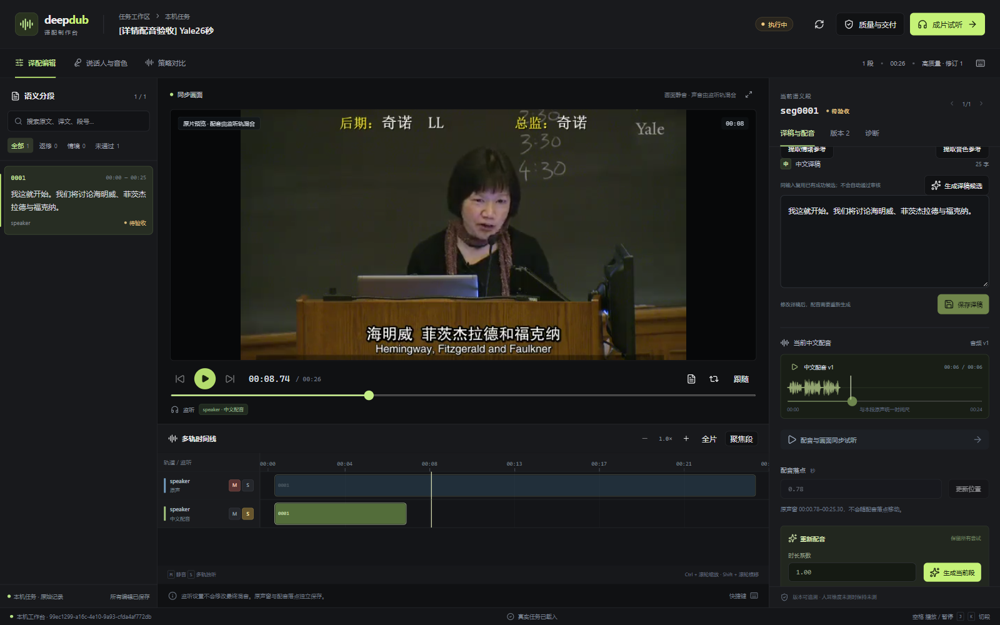

# 真实配音候选、受控模型进程与详情页验收

## 已运行验证

2026-10-18，`apps/deep_dub` 已接通本机 RTX 5060 Ti 的实际 IndexTTS2.5 配音。它是独立业务计算进程，通过 HTTP 调用，不增加平台存储或修改平台镜像；没有接管远端 V100 的既有进程。

| 项目 | 直接证据 |
| --- | --- |
| 工具与进程检查 | `tests/test_deep_dub_owned_tts.py` 7 项、本地池 4 项、参考准备 9 项，共 20 passed；包含真实 HTTP 子进程的成功、上游失败、取消和保留无关进程 |
| 真实 CUDA 集成 | `tests/test_deep_dub_speech_live.py` 最终 2 passed in 58.15s：实际生成/保存/同契约 CLI 重放，以及确认模型 loaded 后的真实推理取消 |
| 候选产物 | 新生成 22050 Hz、单声道 PCM16，146944 样本，6664 ms，RustFS 私有 WAV 和关联 JSON 回执；没有复用旧成片或 WAV |
| 权限 | API 查看者、匿名和外空间拒绝；当前默认自动登记/核验 GPU 需要设备管理权限，不能绕过普通用户权限 |
| 释放边界 | 真实推理取消后，阶段 cancelled，无音频候选；模型进程已退出才释放租约。最终本机没有 `audiocpp_server.exe` 遗留 |
| Web | 独立业务入口 8767/8183 实际点击“生成当前段”，出现新音频 v1、真实波形和多轨配音块；WAV duration=6.664127、readyState=4，无媒体错误。同步试听后视频从约 0.84 秒前进至 8.77 秒并暂停 |
| 取消后的界面 | 验收运行结束取消，刷新后生成译稿、提取参考、TTS 系数和生成按钮均禁用；产物仍可授权读取 |
| Langfuse | 从本机公开 API 实际读回 4 项：`tts_pcm_contract=1`，内容一致性、音色身份、自然度均为 TEXT `not_measured`；v2 observations 的 userId/sessionId 与执行者及运行一致 |
| 构建与数据保护 | TypeScript、Vite 通过，保留入口块大小提示；原 392 条 Agent 的全部状态值保留，结束快照 420 条包含同期其他验收。27 个受保护容器 ID 不变 |

本轮全部是 **acceptance**：取既有原片新截 26 秒、沿用既有第一段原文，人工提供短中文测试文本。短中文并未完整覆盖该段原文，不能拿它作为翻译、语义完整性或整片成品质量通过。所有运行已取消收尾，不是生产完成。



## 契约与实现边界

- `services/speech.py` 接收确切的段、译稿、固定音色和情绪参考 UUID，重新检查同空间、项目、来源、角色和原声时间窗；模型摘要、参数、种子与输入一起冻结。保存不可变候选，不自动审核、选版或移动落点。
- `services/gpu_runtime.py` 领取 GPU 阶段、数据库租约与 fence，每秒续租。`services/model_pool.py` 取得物理 GPU 锁与旧 `tts-router` 的同一把 `local-5060ti.lock`，核对 GPU UUID、序号、进程完整路径白名单和显存余量。未知外部进程直接拒绝，绝不停止它们。桌面图形进程允许共用，不能称为物理整卡独占。
- `nodes/tts.py` 启动本次持有的原生进程，核对监听端口确属本次 PID，通过 `/v1/tasks/run` 分别传固定音色与原声情绪参考。HTTP 超时、业务取消或租约失效都要结束并等待本次 Popen 句柄真正退出；不能仅断开请求就释放 GPU。启动/停止日志保存在私有运行目录，异常未收尾的日志拒绝自动接管。
- 配音阶段完成后，另行使用 CPU 波形阶段准备可视产物。波形准备未完成时允许相同请求重试，复用已生成的成功配音，不偷偷重做 GPU 生成。GET 波形仍只读。
- 本地 CLI、HTTP CLI、Web 调用同一个服务。Web 请求在网络不明时保留原种子和幂等键；成功后再次主动生成使用新种子，并保留历史。时长系数和生成速率取倒数转换，原声窗与配音播放落点独立。

```powershell
# 默认本地执行；先准备同来源执行中运行、译稿与两种参考。
uv run anp deep_dub runs speech <运行UUID> <段UUID> <译稿UUID> <音色参考UUID> <情绪参考UUID> --seed 42 --request-key <幂等键>
uv run anp --transport http --endpoint http://127.0.0.1:8183 deep_dub runs speech <运行UUID> <段UUID> <译稿UUID> <音色参考UUID> <情绪参考UUID> --seed 42 --request-key <同一幂等键>
```

API 是 `POST /api/apps/deep_dub/runs/{run_id}/speech`，请求头带 `Idempotency-Key`。`generation_factor` 范围 0.90–1.35，`timeout_seconds` 为 5–900，`seed` 为非负 32 位整数。Web 时长系数暂保留 0.90–1.10。

## 配置与实际模型身份

本机忽略配置 `config/settings.local.toml` 中 `[deep_dub].tts_config` 指向私有 JSON；环境变量 `ANP_DEEP_DUB_TTS_CONFIG` 可覆盖。公开模板为 `apps/deep_dub/tts.local.example.json`，默认公开路径为空，不自动加载或下载模型。当前默认配置读取已实测，现有 8183 开发进程已加载配置；本轮未重新做 IDE F5 内 TTS 断点验收。

- 原生源码干净提交：`f16f23abf9732b1904fed1f15bddbe9909d21146`。
- 二进制 SHA256：`be820dd89b644b7179614a0444b0be5ad123e81c7794add19619e4cf6a95c81d`。
- 权重完整实算 SHA256：`5e827b2072042e4a1b21ccf24a5cb4f71cb1011403067a0a9b039311d8b38628`。没有把下载清单 etag 当成本机文件摘要。
- 只读解析该 GGUF：3790 个 tensor，family 为 `index_tts2`，内嵌 `config.yaml` 明确 `version: "2.5"`。原生运行器仍提示旧规范元数据，使用当前运行器的 schema-v1 契约；没有改写缓存权重。

本轮修正了一个真实错误：参考是 24 kHz，但模型实际输出 22.05 kHz。最初校验误把输出也限制为 24 kHz，阶段失败记录保留；现在按真实 WAV 头与响应核对，支持该模型的 22.05/24 kHz 输出，没有伪造采样率或回填失败为成功。验收脚本另一次误读租约敏感列被权限拒绝，改为显式读取安全列后通过，没有放宽 ACL。

## 尚未完成

- 当前模型每个阶段冷启动并退出，安全边界先跑通；最终一轮进程生命周期约 19.33 秒，其中请求连同冷加载约 15.16 秒，不能引用上游较小的纯推理 RTF 冒充端到端性能。尚未验证模型安全驻留、跨段批处理、连续峰值显存或远端调度。
- 运行器目前支持 Windows NVIDIA 本机，管理员配置明确的二进制/权重和桌面进程路径。云端或远端模型的上传、认证、取消/接管接口尚未实现，不能把它描述成已支持任意模型 URL。
- GPU 进程崩溃后的自动接管没有完成；遗留日志继续隔离，需核对身份和停止事实。没有结束或卸载远端占用者。
- 当前 WAV 尚未独立回转录、对齐或人耳复核，没有完成事实/数字/否定/专名、音色身份、自然度、背景、字幕、碰撞、成片、整片 RTF≤0.5 或 B 站发布。完整目标继续。

证据：`evidence/deep-dub-speech-20261018.json`。原始测试与模型诊断位于 `.local/deep-dub-speech-*.log` 和 `.local/deep_dub/gpu-pool/model-logs`，均为私有运行数据。
