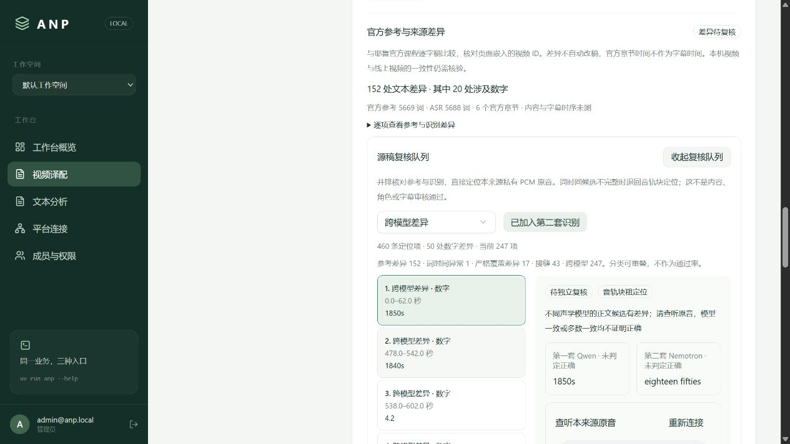

# deep_dub 跨模型源稿复核

状态：已实现跨模型差异的原音定位与同契约读取；完整正文裁决、说话人审核、字幕时钟、正式分段及整片生产仍未通过。本功能不自动放行待审运行。

## 用法

正式工作台的「源稿复核队列」点击「加入第二套识别差异」，可筛选「跨模型差异」。每项并排展示第一套 Qwen、第二套 Nemotron 的差异文本；上下文按需展开，复用私有 PCM 试听。

默认本地 CLI：

```powershell
uv run anp deep_dub projects source-review-queue <项目UUID> <来源UUID> --include-secondary
uv run anp deep_dub projects source-review-queue <项目UUID> <来源UUID> --include-secondary --kind cross_model_difference --limit 10
```

根参数 `--transport http` 使用相同契约；GET `/api/apps/deep_dub/projects/{project}/sources/{source}/review-queue?include_secondary=true` 返回同一结果。默认不加入第二套，原有 213 项的摘要与 ID 保持原值；显式跨模型分类但未加入第二套会返回 422，缺少第二套完整识别证据返回 409。

## 证据与交互边界

- 每次请求重新检查用户权限、空间可见性，读取并验证同来源的原识别、词时间、官方参考和第二套识别证据。第二套证据必须关联同一原识别摘要、PCM 与参考版本，不混用旧证据。
- 新包绑定原包摘要、第二套证据 ID 及完整证据摘要。分页 `expected_hash` 不一致返回 409；跨包分页不能悄悄切换输入。旧问题 ID 保留，新增差异 ID 随第二套证据变化。
- 差异的两个词索引分别映射回各自识别块。插入/删除的空侧取相邻锚点；试听取两侧相关块的并集并增加两秒上下文，只把试听窗限制在真实 PCM 内，不修改原词时间。
- 当前只提供块级粗定位，可能长于单句；不能把其起止点登记为字幕。不同模型一致也不是事实、数字、否定或专名审核通过。数字写法差异如 `1850s` 与 `eighteen fifties` 仍保留，计数不是错误率或准确率。
- 切换问题仍销毁并暂停旧播放器。开关第二套证据会重置分类、分页和选中项，避免残留旧分页摘要。
- 读取不启动模型、不创建执行尝试、不改稿、不登记分段、不提交审核、不改变原运行状态与最早排队时间。

## 本轮验证

真实来源仍为 Yale HIST119 第一讲，同一 `a067cfa8-41ed-4ee6-a4c5-69996512736d` 验收运行。完整 PCM 共 41,380,932 样本；原队列 213 项，加入 247 项跨模型差异后共 460 项，其中 50 项涉及数字。问题分类可能重叠，不能把这些数字作为内容通过率。

首轮冻结服务就绪后，真实读取专项通过（36.32 秒）：全部 460 个稳定 ID、分页、差异筛选、跨空间拒绝、401/409/422、本地 CLI（业务 URL 指向不可达端口）与 HTTP CLI 返回一致。GPU 日志摘要与运行、尝试、审核、分段、译文记录前后相同。原 450 条线程值与完整父子待审检查点保留。

第一次专项在 Compose 切换、服务尚未就绪时失败，错误为 `RemoteProtocolError`；原日志保留在 `.local/deep-dub-cross-review-initial-startup-failure.log`。未据此重跑模型或修改业务运行。最终制品、补充验证和截图见 [公开证据](evidence/deep-dub-cross-review-20261019.json)。

本机冻结制品由包含其他会话未提交修改的工作树构建；不等于新的官方 GHCR 发布或拉取验收。本轮未重新验收 IDE F5、远端 V100、云数据库、整片质量、整片 RTF 或 B 站发布。不得将源稿诊断队列完成当作整体目标完成。

最终制品为 `20261018202357-8b7ef7de`，已重新构建镜像并经 Compose 启动，11 组件 ready，业务 wheel 中本轮 Python 文件与工作树字节相同。24 项工具检查通过（0.41 秒）、TypeScript 检查通过；包含上述真实跨模型读取专项的 28 项平台/业务联合回归通过（120.34 秒）。最终原 450 条线程值全部保留，共 452 条线程，新增两条来自回归；27 个受保护容器 ID 不变，完整待审父子检查点未变化。五库备份的隔离恢复检查通过。


