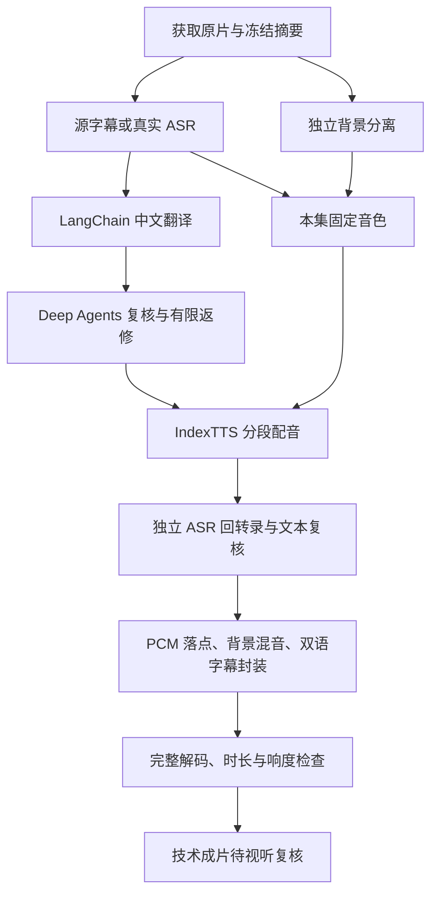

# 对象驱动的视频译配工作流

保留并迁移自参考项目的LangGraph与Deep Agents译配实现。ANP本轮已初始化新Supabase的对象表、复合外键、RLS和本机成员，真实数据库权限测试通过；没有在新项目调用付费翻译、ASR或TTS，也没有复制旧译配结果冒充新结果。

业务代码位于 `business/src/anp_business/dubbing/`，迁移在 `business/supabase/migrations/`。Supabase PostgreSQL保存业务对象，RustFS私有桶 `anp-dubbing` 保存媒体；数据库保留摘要、桶、键及对象关系。业务采用PostgreSQL直连+RLS适配器，并不通过Storage REST读写这些媒体；Supabase Storage API是另一个已部署的平台能力。

## 对象关系

| 对象 | 关系与用途 |
|---|---|
| `workspaces`、`memberships` | 空间及 Supabase `auth.users` 成员；构成 RLS 边界 |
| `projects` | 属于空间，固定源语言与目标语言 |
| `assets` | 属于项目；源片、PCM、分轨、音色、SRT、WAV、成片、回执的私有对象索引 |
| `speakers` | 属于项目；当前自动入口登记一个待复核的默认说话人 |
| `segments` | 绑定准确原片和说话人；保存原文、原窗、顺序、词信息及来源 |
| `translations` | 绑定原文段；不可变版本，保存提示输入、模型路由和返回证据 |
| `voices` | 绑定项目内说话人和实际参考音频；记录原声参考窗 |
| `runs` | 绑定项目；请求、幂等键、状态及时间。重试沿用原运行 |
| `attempts` | 属于运行；阶段、输入摘要、尝试次数、输出引用、失败原因 |
| `syntheses` | 同时绑定运行、段、准确译稿版本、固定音色和实际 WAV；每运行每段最多一个选中候选 |
| `reviews` | 属于运行；审核对象集合摘要、结论及证据，不覆盖历史失败 |
| `deliverables` | 绑定运行与准确成片资产；清单指向采用的译稿和配音候选 |

复合外键约束空间、项目和对象归属，不能把其他项目的原片挂到本项目段上，也不能把一段的译稿用于另一段配音。RLS 对匿名关闭业务表权限；后台事务显式切换到 `authenticated`，绑定可信身份后再查询。模型密钥和数据库管理员连接只在私有后台配置中，前端没有这些凭据。RLS 规则遵循 [Supabase 官方说明](https://supabase.com/docs/guides/database/postgres/row-level-security)。

当前 HTTP 为**回环地址上的固定开发身份**，不是已完成的多用户登录系统。它拒绝外部 Host/Origin；Docker 只发布到 `127.0.0.1`。部署多人环境前，需要接 Supabase Auth 验证 JWT，并以验证所得用户身份执行 RLS，不能把请求正文里的用户 ID 当认证。

## 编排和恢复

- 翻译/源稿与背景分支并行，GPU 推理领取同一物理设备的共享文件锁，不把多个模型端口当成多块卡。原生模型只启动本项目持有的进程，只结束自己的 Popen 句柄；不接管现有音频服务。
- 分离按 60 秒连续 PCM 样本处理并校验格式和实际帧数，已完成块可凭输入/输出摘要复用。ASR 按 20 秒有界窗口识别。分块端点没有自动变成通过审核的语义边界。
- 翻译使用 LangChain `ChatOpenAI` 接 LiteLLM；Deep Agent 必须调用绑定材料工具，提交完整且准确的段 ID 集合。实质错误最多两轮改译并独审，不覆盖旧稿。
- 配音冻结一集的参考，使用 IndexTTS 原生时长系数，倍率在 `0.90–1.35`；三次候选仍越界则失败，保留候选，不裁掉语音凑长度。
- 回转录比较的是**真实生成的 WAV**和采用的中文译稿，另一次模型请求完成语义核对；不能据此声称模型听过音色、自然度或背景。
- 每阶段成功结果写 Supabase。显式重试时，输入摘要一致的成功阶段复用，不重复付费。执行者崩溃后，未知完成状态保留为失败尝试，显式重试可能重新调用未知上游请求；不承诺跨外部 API 的 exactly-once。
- 整次运行用 PostgreSQL advisory lock 防重入。HTTP 启动一个轻量业务进程，长译配不阻塞 ASGI 热重载，不引入 Celery 或另一套任务系统。
- 取消表示阻断后续提交/阶段；已经在执行的本机调用完成或超时后才释放本项目进程和锁，不声称关闭 HTTP 等于上游停止计费。

Deep Agents 复核以实际工具调用和结构化结果留证，设计参考[官方说明](https://github.com/langchain-ai/docs/blob/main/src/oss/deepagents/overview.mdx)。底层仍是 LangGraph，业务对象和阶段记录承担这版的恢复真源。

## 新项目配置与入口

执行 `make init`、`make up`、`make dub-migrate`、`make dev`。工作台为 `http://127.0.0.1:51760/workbench/`，点击视频译配。宿主输入放 `var/dubbing/inputs/`；没有业务容器路径映射。`make dub-config` 只补齐本项目配置，不自动读取相邻项目、GPU软件或权重。

真实供应商需在私有 `business/.env` 设置 `ANP_DUB_MODEL_BASE_URL`、`ANP_DUB_MODEL_API_KEY`、`ANP_DUB_MODEL`、`ANP_DUB_REVIEW_MODEL`，以及 `ANP_DUB_AUDIO_CONFIG`。音频配置可选已授权的原生计算端或字节桥；不会自动接管现有模型进程。配置前调用真实译配会明确报告缺失配置，不回落为伪造媒体。

`make dub-run INPUT=var/dubbing/inputs/video.mp4` 登记并执行，`make dub-list` 查看对象。F5另有“ANP: 视频译配 CLI（断点）”配置。新的本机固定开发身份与旧库独立；共享或公网部署前必须接入真实Supabase Auth身份验证。
