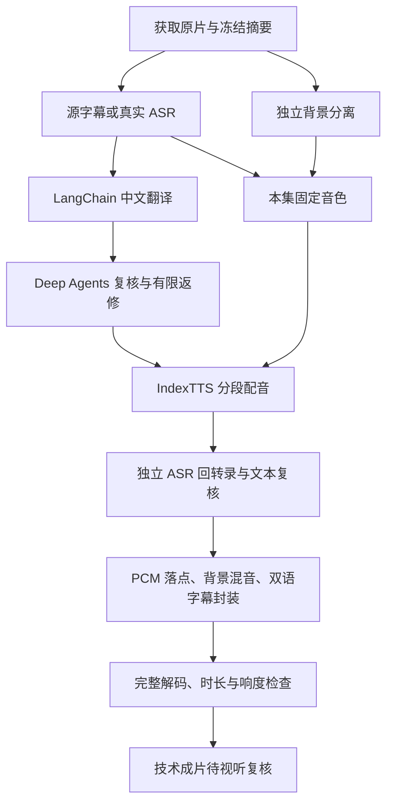

# 对象驱动的视频译配工作流

本轮依据本机会话“梳理视频译配全流程”及其 `dagu/README.md` 落地。该会话仍有其他生产任务运行；本项目只读其设计，没有接续、审批或改写那些任务，也没有修改 `../anp` 的容器、配置或数据。

当前已贯通**英文单说话人视频 → 中文配音与双语字幕 MP4**：真实 ASR、分轨、翻译、Deep Agents 文本复核、IndexTTS、独立回转录、混音、完整解码和响度检查。短片分别通过 CLI、开发工作台和 Docker 入口运行。结果为 `ready_for_review`，源稿听辨、说话人身份、音色、自然度、背景听辨与最终视听没有冒充通过。

## 目录与职责

```text
business/
  supabase/migrations/                  领域对象、外键与 RLS
  src/anp_business/dubbing/
    settings.py                        宿主、外部资源及容器配置
    repository.py                      Supabase PostgreSQL 直连与 RLS 事务
    service.py                         幂等登记、运行锁、取消与查询
    graph.py                           LangGraph 并行图与阶段恢复
    nodes.py                           输入、译稿、音色、配音、封装与验收
    review.py                          Deep Agents 只读工具与独立复核
    providers.py                       LangChain 模型网关、原生音频/字节桥
    media.py                           私有对象存储、摘要与 FFmpeg
    worker.py                          一次译配一个独立进程
    audio_worker.py                    独立的宿主音频计算端
    api.py                             工作台使用的对象 API
  ui/src/components/dubbing.tsx         对象、阶段、候选与成片页面
scripts/dubbing.py                      配置、迁移、CLI 与计算端入口
var/config/dubbing/                     私有音频配置；不提交
var/config/services/dubbing.env         容器连接配置；不提交
var/dubbing/                           宿主运行、输入、缓存及日志；不提交
docker/business/                       业务镜像和 Compose
```

Supabase 的 PostgreSQL 是业务对象真源。当前采用直连适配器，不要求为了保存对象先启动 Studio、Auth、PostgREST 全家桶；SQL 可部署到本地 Supabase PostgreSQL 或兼容的托管 Supabase。视频和 WAV 放在本项目 RustFS 私有桶，数据库保存桶、对象键、摘要及引用。**这不是把 RustFS 包装成已经部署好的 Supabase Storage API。**

本轮没有构建、启动或联调完整 Supabase 平台套件。其源码构建入口仍在 `docker/platform/supabase/`，与本业务直连方式分别验证。

## 对象关系

| 对象 | 关系与用途 |
|---|---|
| `workspaces`、`memberships` | 空间及 Supabase `auth.users` 成员；构成 RLS 边界 |
| `projects` | 属于空间，固定源语言与目标语言 |
| `assets` | 属于项目；源片、PCM、分轨、音色、SRT、WAV、成片、回执的私有对象索引 |
| `speakers` | 属于项目；当前自动入口登记一个待复核的默认说话人 |
| `segments` | 绑定准确原片和说话人；保存原文、原窗、顺序、词信息及来源 |
| `translations` | 绑定原文段；不可变版本，保存提示输入、模型路由和返回证据 |
| `voices` | 绑定项目内说话人和实际参考音频；记录原声参考窗 |
| `runs` | 绑定项目；请求、幂等键、状态及时间。重试沿用原运行 |
| `attempts` | 属于运行；阶段、输入摘要、尝试次数、输出引用、失败原因 |
| `syntheses` | 同时绑定运行、段、准确译稿版本、固定音色和实际 WAV；每运行每段最多一个选中候选 |
| `reviews` | 属于运行；审核对象集合摘要、结论及证据，不覆盖历史失败 |
| `deliverables` | 绑定运行与准确成片资产；清单指向采用的译稿和配音候选 |

复合外键约束空间、项目和对象归属，不能把其他项目的原片挂到本项目段上，也不能把一段的译稿用于另一段配音。RLS 对匿名关闭业务表权限；后台事务显式切换到 `authenticated`，绑定可信身份后再查询。模型密钥和数据库管理员连接只在私有后台配置中，前端没有这些凭据。RLS 规则遵循 [Supabase 官方说明](https://supabase.com/docs/guides/database/postgres/row-level-security)。

当前 HTTP 为**回环地址上的固定开发身份**，不是已完成的多用户登录系统。它拒绝外部 Host/Origin；Docker 只发布到 `127.0.0.1`。部署多人环境前，需要接 Supabase Auth 验证 JWT，并以验证所得用户身份执行 RLS，不能把请求正文里的用户 ID 当认证。

## 编排和恢复



- 翻译/源稿与背景分支并行，GPU 推理领取同一物理设备的共享文件锁，不把多个模型端口当成多块卡。原生模型只启动本项目持有的进程，只结束自己的 Popen 句柄；不接管现有音频服务。
- 分离按 60 秒连续 PCM 样本处理并校验格式和实际帧数，已完成块可凭输入/输出摘要复用。ASR 按 20 秒有界窗口识别。分块端点没有自动变成通过审核的语义边界。
- 翻译使用 LangChain `ChatOpenAI` 接 LiteLLM；Deep Agent 必须调用绑定材料工具，提交完整且准确的段 ID 集合。实质错误最多两轮改译并独审，不覆盖旧稿。
- 配音冻结一集的参考，使用 IndexTTS 原生时长系数，倍率在 `0.90–1.35`；三次候选仍越界则失败，保留候选，不裁掉语音凑长度。
- 回转录比较的是**真实生成的 WAV**和采用的中文译稿，另一次模型请求完成语义核对；不能据此声称模型听过音色、自然度或背景。
- 每阶段成功结果写 Supabase。显式重试时，输入摘要一致的成功阶段复用，不重复付费。执行者崩溃后，未知完成状态保留为失败尝试，显式重试可能重新调用未知上游请求；不承诺跨外部 API 的 exactly-once。
- 整次运行用 PostgreSQL advisory lock 防重入。HTTP 启动一个轻量业务进程，长译配不阻塞 ASGI 热重载，不引入 Celery 或另一套任务系统。
- 取消表示阻断后续提交/阶段；已经在执行的本机调用完成或超时后才释放本项目进程和锁，不声称关闭 HTTP 等于上游停止计费。

Deep Agents 复核以实际工具调用和结构化结果留证，设计参考[官方说明](https://github.com/langchain-ai/docs/blob/main/src/oss/deepagents/overview.mdx)。底层仍是 LangGraph，业务对象和阶段记录承担这版的恢复真源。

## 启动与调试

首次在 `E:\anp2`：

```powershell
make storage
make dub-config
make dub-migrate
make dev
```

打开 `http://127.0.0.1:51730/workbench/`，选择“视频译配”。现有配置已复制必要 LiteLLM key 和模型软件/权重位置；不复制旧业务数据库、不复用旧译稿、音色或配音文件。`make dub-config` 保留已有宿主配置和已有容器私有 env，后续编辑私有文件切换上游。

本地视频须位于 `ANP_DUB_INPUT_ROOTS` 指定目录（多个目录用 `|`）或本项目 `var/dubbing` 内。默认接收 `var/dubbing/inputs/`；既可输入原生路径，也可用 `file://`。可选英文 SRT 走同样的目录与摘要检查。没有字幕时实际 ASR，不生成伪字幕。

```powershell
make dub-run INPUT="E:/anp2/var/dubbing/inputs/science-workshop.mp4"
make dub-list
make dub-show RUN="运行UUID"
make dub-retry RUN="失败运行UUID"
make dub-test
```

URL 路线使用锁定的 yt-dlp，最高可用视频与音轨、单视频下载，保留来源信息和可用英文字幕。当前入口允许 YouTube、B 站和 TED 的明确 HTTPS 视频地址；本轮**没有进行新的公网 URL 下载验收**，网站登录、风控和字幕可用性仍取决于上游。浏览器不把任意内网 URL 交给下载器。

容器方式：

```powershell
# 单独终端，启动本项目的音频计算端；Ctrl+C 停止
make dub-worker

# 另一终端
make build
make up
```

容器工作台是 `http://127.0.0.1:52024/workbench/`，输入 `/app/dubbing-inputs/文件名.mp4`。宿主 `var/dubbing/inputs` 只读挂入容器。音频计算端监听回环 `18191`，容器通过 Docker Desktop 的 `host.docker.internal` 访问，持私有令牌上传实际音频字节；不传 Windows 本地路径。计算端调用的原生模型使用独立 `18190`，只在计算时启动。可将桥协议计算端部署到另一台有 GPU 的机器，通过私有配置替换连接。

容器中的 FFmpeg 负责实际混音/解码，模型权重不塞进业务镜像。音频计算端目前是可独立启动的宿主适配器，不是新增的常驻基础设施容器。

Qoder/VS Code 使用已有 **ANP2: 一键前后端热重载** 复合配置，F5 自动启动四存储、Vite HMR 和原生 LangGraph 调试端口 `56790`。可在 `dubbing/api.py` 调试请求入口，在 `dubbing/nodes.py` 调试译配阶段。业务独立子进程的调试依赖 debugpy 子进程附加；新增 **ANP2: 视频译配 CLI（断点）** 配置，输入视频地址后直接调试 `scripts/dubbing.py run ...`。前端无交互 stdin 的开发任务设置了 `CI=true`，避免 Vite 因 stdin 结束而退出，HMR 保留。

## 当前验收范围

本轮使用**新生成的约 13.56 秒英文科学工作坊测试片**，不复用目标会话的成片或旧 WAV。一次 CLI、一次浏览器创建、一次 Docker/计算端分别生成了新的中文译稿和配音。它验证技术链路及对象关系，不代表 40 分钟课程、多说话人、专业翻译质量或完整 RTF≤0.5 达标。

现阶段自动源稿入口登记默认说话人；词时间、角色身份、背景泄漏/事件和最终视听没有专业审核闭环。无法确认的项明示 `not_measured`，成片保留为 `ready_for_review`。多角色自动识别、人工分段编辑、源词链硬门禁、背景修复和最终批准/发布属于下一步领域能力，不能从这次短片贯通推导为已完成。

验收证据见 `docs/evidence/dubbing-acceptance.json` 和 `docs/evidence/dubbing-workbench.png`。原始命令日志、运行对象引用及本机缓存留在 `var/dubbing/`，容器运行缓存留在独立 business bind 目录。

另以真实 Deep Agent 检验了故意错误的译稿：将十五美元改为五十美元、把“不要喝水”改为“请喝水”，两处均被判失败并给出中文原因，见 `docs/evidence/dubbing-negative-review.json`。本轮启用数据库集成验证时共 18 项测试通过，覆盖跨空间拒绝、跨项目外键、幂等、取消、阶段复用、Range 媒体读取和耗尽候选后禁止原样付费重试。`make dub-check RUN="已完成运行UUID"` 可复核容器的原生图重放及媒体读取，不重新译配。
